# 🚢 Titanic Survival Prediction — EDA, PyTorch & Streamlit

An end-to-end binary classification project for the **[Kaggle Titanic competition](https://www.kaggle.com/competitions/titanic/data)**. It combines an executed **exploratory data analysis (EDA) notebook**, statistically motivated feature engineering, **PyTorch** neural-network training, a logistic-regression baseline, and an interactive **Streamlit** evaluation/inference dashboard.

**Dataset policy:** Only the labeled Kaggle `train.csv` is used. The competition's `test.csv` and `gender_submission.csv` are **not used**. A local copy of `train.csv` can be kept in the project root or fetched from Kaggle with `--download`.

## Project overview

| Stage | Implementation |
| --- | --- |
| EDA | Descriptive statistics, missingness, outliers, distributions, associations and correlation analysis |
| Preprocessing | Training-only median imputation, numeric scaling and one-hot encoding |
| Features | Raw passenger fields + seven engineered variables |
| Model selection | 5-fold stratified cross-validation on the development partition |
| PyTorch model | MLP with hidden layers `(32, 16)`, ReLU, dropout and AdamW |
| Baseline | Logistic regression with the same training split and transformed features |
| Inference | Streamlit: local CSV path, CSV upload, probability predictions and CSV export |
| Evaluation | Accuracy, precision, recall, F1, ROC AUC, confusion matrix, ROC/PR curves and calibration |

### Project structure

The repository root contains the training script, Streamlit app and EDA notebook. Training, preprocessing, evaluation, and inference are organized into reusable Python modules in src/.

```text
.
├── README.md
├── requirements.txt
├── train.py                     # PyTorch training + CV model selection
├── ds_app.py                    # Streamlit dashboard and CSV inference
├── titanic_eda.ipynb            # Jupyter / Colab EDA notebook
├── train.csv                    # Kaggle's labeled train.csv, if saved locally
├── src/
│   ├── __init__.py
│   ├── data.py
│   ├── features.py
│   ├── model.py
│   └── evaluation.py
├── data/
│   └── example_inference.csv    # Small sample to upload in Streamlit
├── docs/
│   └── eda/                     # Plots shown below
├── tests/                       # Unit and pipeline tests
└── artifacts/                   # Written by train.py after training
```

## Installation and running the project

### 1. Clone the repository

Install **Python 3.11 or 3.12** and Git, then open a terminal:

```bash
git clone https://github.com/TalShwartzz/titanic.git
cd titanic
```

All commands below should be run from the folder containing `train.py` and `ds_app.py`.

### 2. Create a virtual environment and install requirements

**Windows (PowerShell / PyCharm terminal):**

```powershell
py -3.12 -m venv .venv
.\.venv\Scripts\python.exe -m pip install --upgrade pip
.\.venv\Scripts\python.exe -m pip install -r requirements.txt
```

Replace `py -3.12` with your installed Python 3.11 or 3.12 executable if needed. Using `.venv\Scripts\python.exe` explicitly avoids problems caused by mixing different Python installations.

**macOS / Linux:**

```bash
python3 -m venv .venv
source .venv/bin/activate
python -m pip install --upgrade pip
python -m pip install -r requirements.txt
```

`requirements.txt` installs PyTorch, scikit-learn, pandas, Streamlit, plotting libraries, Jupyter, and the other project dependencies. **Do not commit your `.venv/` directory.**

> In the examples below, `python` means the installed project environment. On Windows without activating the venv, replace `python` by `.\.venv\Scripts\python.exe` in each command.

### 3. Obtain the Titanic dataset

Only the labeled [Kaggle Titanic `train.csv`](https://www.kaggle.com/competitions/titanic/data) is used. If `train.csv` is already next to `train.py`, **no download is necessary**.

Otherwise, download `train.csv` from Kaggle and copy it to the repository root:

```text
titanic/
├── train.csv
├── train.py
└── ds_app.py
```

Alternatively, configure your Kaggle API credentials and fetch **only `train.csv`** with:

```bash
python train.py --download --cv-folds 5 --cv-epochs 30 40 --device cpu
```

Do not use Kaggle's `test.csv` or `gender_submission.csv` for model evaluation. Training and validation rows are split from the labeled `train.csv`.

### 4. Train and evaluate the PyTorch classifier

**Recommended: 5-fold stratified cross-validation** on the development partition selects a feature configuration and epoch count:

```bash
python train.py --cv-folds 5 --cv-epochs 30 40 --device cpu
```

For a quicker demonstration that skips cross-validation and trains on all engineered features for 40 epochs:

```bash
python train.py --no-cv --epochs 40 --device cpu
```

You can use `--device auto` to select a CUDA GPU when a compatible CUDA-enabled PyTorch installation is available. Optional arguments include `--data-path`, `--output-dir`, `--batch-size`, `--learning-rate`, and `--seed`.

The script creates `artifacts/` containing the trained weights and fitted preprocessing (`model.pt`, `preprocessor.joblib`, `model_config.json`), along with evaluation outputs. **Train before starting Streamlit** unless those exact compatible artifacts are already present.

### 5. Run the Streamlit application

```bash
python -m streamlit run ds_app.py
```

Open the **Local URL** printed in your terminal (usually `http://localhost:8501`). Run Streamlit via the command above, **not** `python ds_app.py`.

In the sidebar, point the app to `artifacts/` if needed. You can select held-out validation, provide a local CSV path, or upload `data/example_inference.csv`.
### Streamlit Dashboard

The application provides interactive survival predictions,
classification metrics, confusion matrices, and ROC/PR curves.

**Held-out Validation (179 passengers)**

Accuracy: 0.832 | ROC AUC: 0.877

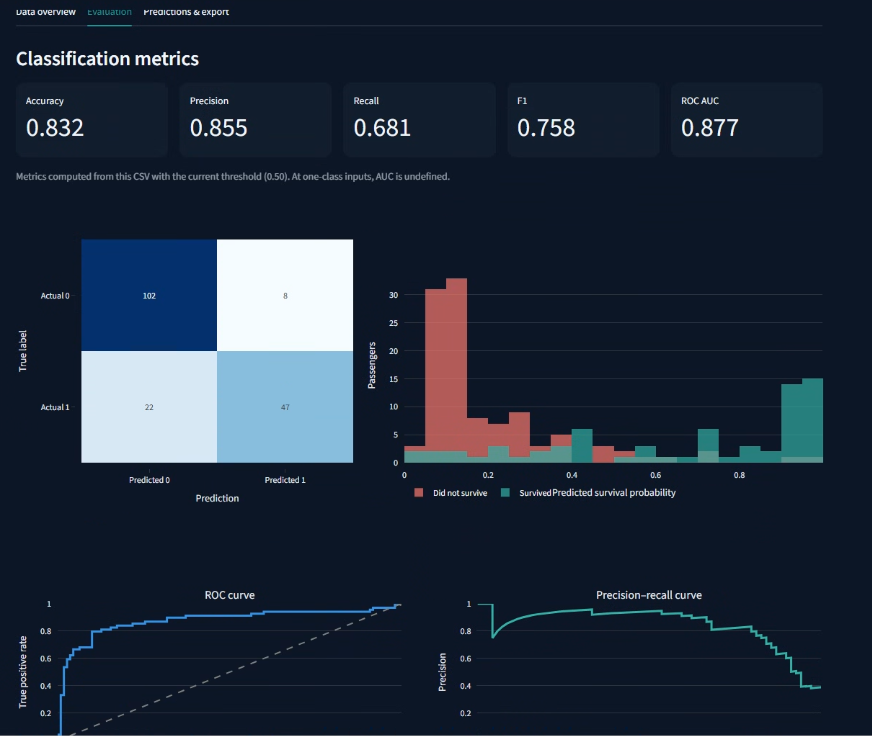

**Additional Evaluation Example (50 passengers)**

Accuracy: 0.860 | ROC AUC: 0.939

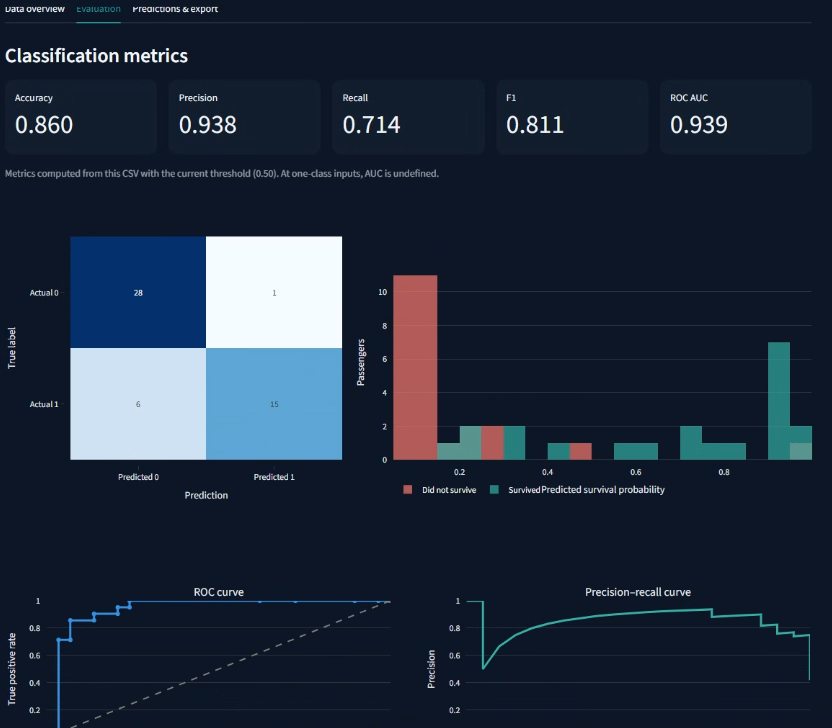

The second screenshot demonstrates evaluation on a smaller
labeled CSV and is not an independent test of model generalization.

### 6. Run the EDA notebook

Open the notebook at the repository root:

```bash
jupyter lab titanic_eda.ipynb
```

If the Jupyter executable is not on your path, use `python -m jupyterlab` and open `titanic_eda.ipynb`. You may alternatively upload the notebook to **Google Colab** and upload the local `train.csv` through the notebook's file-upload prompt. 

### 7. Run automated tests

```bash
python -m pytest -q
```

### Troubleshooting

- **`ModuleNotFoundError: No module named 'src'`** — confirm the `src/` folder is uploaded beside `train.py`, and run the commands from the repository root.
- **Missing model artifacts in Streamlit** — run `train.py` first or select the correct `artifacts/` directory in the app.
- **Streamlit `missing ScriptRunContext` warnings** — use `python -m streamlit run ds_app.py`, not the IDE's ordinary Python run button.
- **Notebook can't find `train.csv`** — keep it beside the notebook locally or upload it to the Colab runtime when prompted.

## EDA: evidence behind the preprocessing

The plots below are **exported from the executed notebook** (`titanic_eda.ipynb`), using the 712-passenger development subset of Kaggle `train.csv` (seed 42). They are real notebook outputs, **not illustrative charts**.

### 1. Descriptive statistics: mean, median and variability

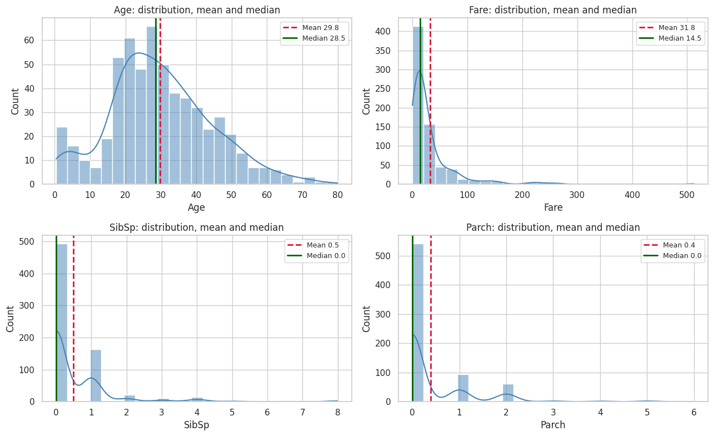

The `Fare` distribution is strongly right-skewed: the development-set median is **14.45**, and raw-fare skewness is approximately **4.65**. `LogFare = log1p(Fare)` is considered to compress the tail. Raw observations are not arbitrarily removed just because they are large.

### 2. Missing values and missingness patterns

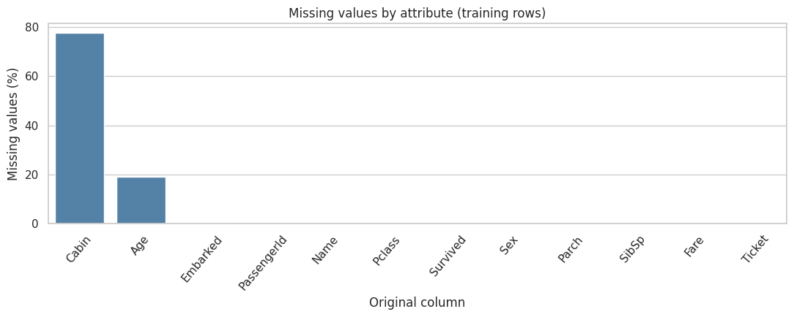

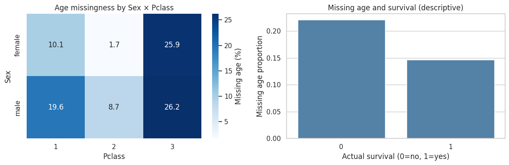

Approximately **19.24%** of `Age` and **77.53%** of `Cabin` are missing within the development partition. Thus, the pipeline median-imputes numerical variables, retains an `AgeMissing` indicator, and omits raw `Cabin`. Categorical missing/unknown values are handled without looking at held-out statistics. Different missingness rates across groups are observational associations, not proof of causality.

### 3. Class balance

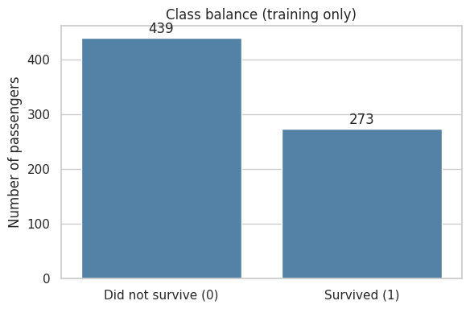

The development-set survival rate is about **38.34%**. We preserve the relative class distribution using a stratified split, and report **F1 and ROC AUC** in addition to accuracy. No class reweighting or oversampling is automatically applied.

### 4. Survival relationships and interactions

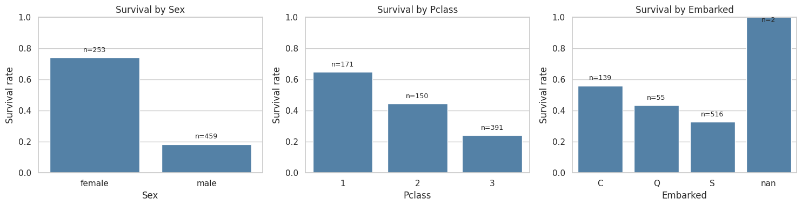

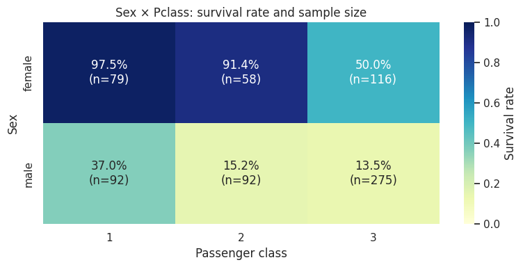

Survival varies strongly by **sex** and **passenger class**, and their combination is informative. This motivates the explicit categorical interaction `SexPclass`. The plots show descriptive relationships only; they should not be interpreted as causal estimates.

### 5. Distributions by survival and outlier checks

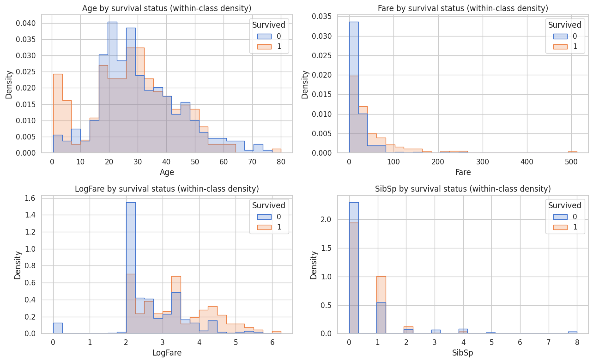

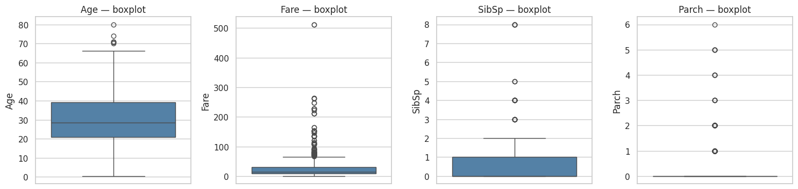

The notebook compares class-conditional distributions and detects possible outliers using the **IQR rule**. A flagged value is not necessarily erroneous; the model retains valid high fares and family-size observations.

### 6. Family features and redundancy

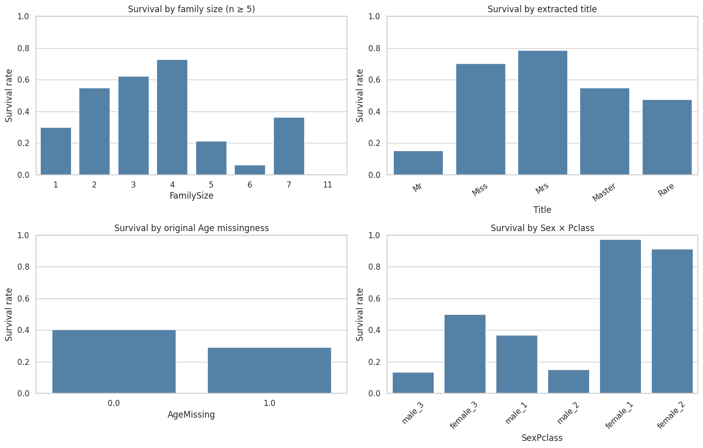

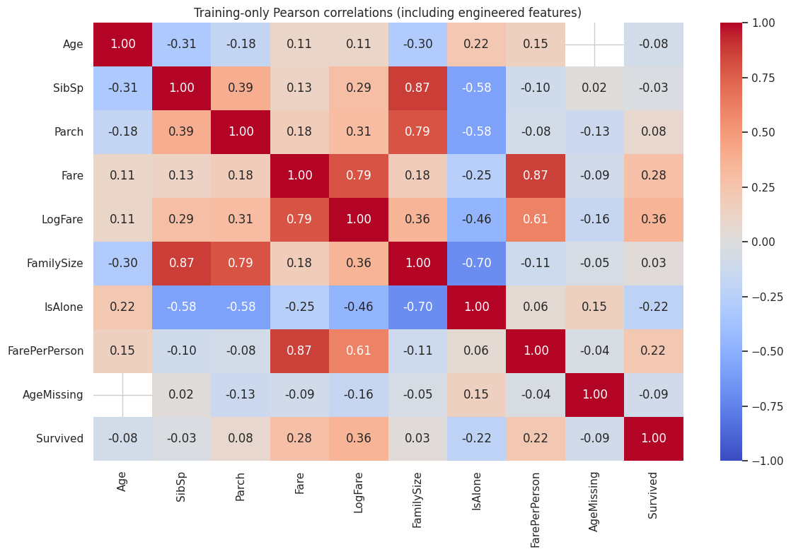

The feature set includes `FamilySize = SibSp + Parch + 1`, `IsAlone`, and `FarePerPerson`. Correlation checks reveal engineered variables that are mathematically related to original variables; these correlations are used as diagnostics, **not** to automatically delete features.

### 7. Feature ablation from the notebook

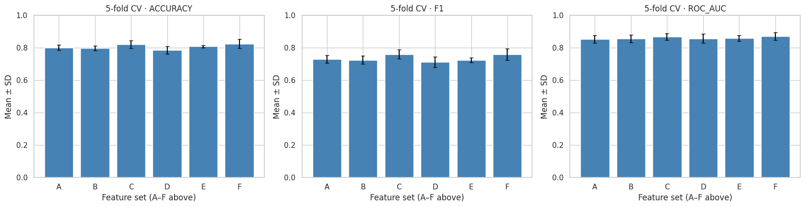

Logistic-regression five-fold stratified CV on the development partition:

| Input feature configuration | Mean ROC AUC | Fold SD |
| --- | ---: | ---: |
| Original passenger fields | 0.8532 | 0.0242 |
| Original + family features | 0.8561 | 0.0241 |
| Original + title | 0.8684 | 0.0217 |
| Original + log fare | 0.8581 | 0.0278 |
| Original + sex/class interaction | 0.8607 | 0.0177 |
| **All engineered features** | **0.8718** | 0.0229 |

This notebook ablation uses **logistic regression** as a diagnostic comparison. The training script separately evaluates the feature groups with **PyTorch** before selecting the final configuration.

## Engineered features and preprocessing

| Feature | Derivation |
| --- | --- |
| `FamilySize` | `SibSp + Parch + 1` |
| `IsAlone` | `FamilySize == 1` |
| `FarePerPerson` | `Fare / FamilySize` (approximation, not actual ticket allocation) |
| `Title` | Extracted from `Name`, with infrequent titles grouped |
| `LogFare` | `log1p(max(Fare, 0))` |
| `AgeMissing` | Indicator for missing `Age` |
| `SexPclass` | Combined `Sex` and `Pclass` category |

The selected **all-feature** configuration from the reported full-data run generated **29 model inputs** after one-hot encoding and numeric transformation. This count can differ for a different dataset whose categorical levels differ.

Every CV fold fits its own imputer, scaler and one-hot encoder on **fold-training rows only**; the final model fits them on the full development subset. Validation rows are never used to fit preprocessing statistics.

## Model results

**PyTorch 5-fold cross-validation results** (original Titanic `train.csv`; 712 development rows, 179 validation rows):

| PyTorch input set | 30 epochs: mean AUC ± SD | 40 epochs: mean AUC ± SD |
| --- | ---: | ---: |
| Original | 0.860 ± 0.026 | 0.863 ± 0.025 |
| Title | 0.870 ± 0.022 | 0.871 ± 0.024 |
| **All engineered** | **0.877 ± 0.024** | **0.878 ± 0.025** |

The model-selection procedure chose **all engineered features, 40 epochs**. Held-out validation performance at a classification threshold of 0.50:

| Model | Accuracy | Precision | Recall | F1 | ROC AUC |
| --- | ---: | ---: | ---: | ---: | ---: |
| PyTorch MLP | 0.832 | 0.855 | 0.681 | 0.758 | **0.877** |
| Logistic regression | **0.838** | **0.857** | **0.696** | **0.768** | 0.872 |

Differences are small, and a small validation subset cannot establish definitive superiority.
Model selection was performed using 5-fold cross-validation on the development set. The reported validation results provide an additional performance estimate, rather than an independent external test.

## Testing and limitations

```bash
python -m pytest -q
```

Tests cover reproducible splitting, preprocessing, checkpoint loading, predictions and cross-validation selection. Demo examples and synthetic test fixtures are **not** independent evidence of model accuracy.

The classification threshold is a modeling decision: lowering it typically increases recall while sacrificing precision; raising it typically increases precision while reducing recall. Choose a deployment threshold using an appropriate development-set criterion, not by tuning repeatedly on the final validation rows.

**Dataset:** [Kaggle — Titanic: Machine Learning from Disaster](https://www.kaggle.com/competitions/titanic/data).
